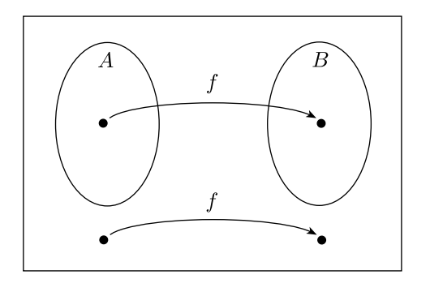

---
# try also 'default' to start simple
theme: ./unc-cs
title: Undecidability, Reducibility, and Rice's Theorem
info: |
  ## Slides for 455
# 455 Class Slides
class: text-center
# https://sli.dev/features/drawing
drawings:
  persist: false
# slide transition: https://sli.dev/guide/animations.html#slide-transitions
transition: fade
# enable Comark Syntax: https://comark.dev/syntax/markdown
comark: true
# duration of the presentation
duration: 35min
kicker: COMP 455 · Models of Languages and Computation
layout: cover

---

# Undecidability, Reducibility, and Rice's Theorem

---

# Review: Decidability

Recall the definition of decidability and how it differs from recognizability:

<v-clicks>

For a language $L$ on machine $M$, $L$ is **Turing-recognizable** iff $M$

* accepts if the input is in $L$
* rejects *or loops forever* if the input is not in $L$

$L$ is **Turing-decidable** iff $M$

* accepts if the input is in $L$
* rejects if the input is not in $L$

</v-clicks>

---

# Review: Known Decidable Acceptance Problems

Acceptance is decidable for each of the less powerful models of computation:

* $A_{DFA} = \{\langle B, w \rangle \mid B \textrm{ is a DFA that accepts input string } w\}$
* $A_{NFA} = \{\langle B, w \rangle \mid B \textrm{ is an NFA that accepts input string } w\}$
* $A_{REX} = \{\langle B, w \rangle \mid B \textrm{ is a regular expression that generates string } w\}$

<v-click>

But for Turing Machines:

$$A_{TM} = \{\langle M, w \rangle \mid M \textrm{ is a Turing Machine and accepts } w \}$$

is **undecidable**: no TM always produces the correct answer in finite time.

We proved this by contradiction, using **diagonalization**.

</v-click>

---

# Review: A First Look at Reductions

<v-clicks>

To finish disproving the Entscheidungsproblem, Turing used a **reduction**: a way of using a solution to one problem to solve another.

If we can turn problem $A$ into problem $B$ ("$A$ reduces to $B$"), then:

* If $B$ is solvable, then $A$ is solvable.
* Contrapositive: if $A$ is unsolvable, then $B$ is unsolvable.

Today we'll make this idea precise and use it to prove many more problems undecidable.

</v-clicks>

---

# Overview

How do we *prove* that a problem is *not* decidable, or **undecidable**?

The main approach: reduce a problem we already know is undecidable to the new problem. Our first "known undecidable problem" is $A_{TM}$.

Today:
<v-clicks>

- Reduce $A_{TM}$ to $HALT_{TM}$, showing $HALT_{TM}$ is also undecidable.

- Formally define the two types of reducibility.

- Do another reduction example.

- Rice's Theorem

</v-clicks>

---

# Reducibility

<v-clicks>

The primary method used to prove that problems are unsolvable is *reducibility*.

Given two problems $A$ and $B$,
a *reduction* is a way of converting problem $A$ to problem $B$ in such a way that a solution to $B$ can be used to solve $A$. 
If this is the case then you can say "$A$ is reducible to $B$."

## Ramifications of Reducibility

If $A$ is reducible to $B$ and $B$ is decidable, then that means $A$ is decidable! 

Similarly, if $A$ is reducible to $B$ and $A$ is undecidable, then $B$ is undecidable. 

(This second line of reasoning shows how we will prove the undecidability of other problems.)

</v-clicks>

---

# Proof Approach

<v-clicks>

Say we know $A$ is undecidable. 

We are trying to prove that $B$ is undecidable. 

This will be a proof by contradiction. 

1. Assume $B$ *is* decidable. (Assume we have a TM that decides $B$.)
2. Demonstrate that $A$ is reducible to $B$.
3. Therefore $A$ must be decidable. However, we already know $A$ is undecidable, so we reach a contradiction.

</v-clicks>

---

# Example: The Halting Problem

<v-clicks>

Another common question is: "Will a Turing machine *halt* on this input or will it loop forever?"

This can be expressed as:
$$HALT_{TM} = \{\langle M, w \rangle \mid M \textrm{ is a Turing Machine and halts on input } w \}$$

$HALT_{TM}$ is also not Turing-decidable. Let's prove it using the idea of reducibility.

We know $A_{TM}$ is undecidable. So, we need to show that $A_{TM}$ is reducible to $HALT_{TM}$.

</v-clicks>

---

# Proof

Assume we have a TM $R$ that decides $HALT_{TM}$. We will use $R$ to construct a TM $S$ that decides $A_{TM}$.

<!-- <v-click>

$$
\begin{aligned}
S = &\textrm{ ``On input } \langle M, w \rangle\textrm{:}\\
& 1. \textrm{ Run TM $R$ on input $\langle M, w \rangle$.} \\
& 2. \textrm{ If $R$ rejects, \emph{reject}.}\\
& 3. \textrm{ If $R$ accepts, simulate $M$ on $w$ until it halts.}\\
& 4. \textrm{ If $M$ has accepted, \emph{accept}; if $M$ has rejected, \emph{reject}.''}
\end{aligned}
$$

</v-click>

<v-click>

$S$ always halts and decides $A_{TM}$, which contradicts $A_{TM}$ being undecidable.

</v-click> -->

<!-- ---

# Other Undecidable Problems

Other common problems can be shown to be undecidable in a similar way:

* $A_{TM} = \{\langle M, w \rangle \mid M \textrm{ is a Turing Machine and accepts } w \}$
* $HALT_{TM} = \{\langle M, w \rangle \mid M \textrm{ is a Turing Machine and halts on input } w \}$
* $E_{TM} = \{\langle M \rangle \mid M \textrm{ is a Turing Machine and } L(M) = \emptyset \}$
* $NE_{TM} = \{\langle M \rangle \mid M \textrm{ is a Turing Machine and } L(M) \neq \emptyset \}$
* $REGULAR_{TM} = \{\langle M \rangle \mid M \textrm{ is a Turing Machine and } L(M) \textrm{ is a regular language} \}$
* $EQ_{TM} = \{\langle M_1, M_2 \rangle \mid M_1 \textrm{ and } M_2 \textrm{ are Turing Machines and } L(M_1) = L(M_2) \}$ -->

---

# Types of Reducibility

<v-clicks>

Sometimes classic reducibility is challenging to prove, so there's another approach we can use.

If we know $A$ is undecidable and we want to reduce $A$ to $B$ to show that $B$ is undecidable, we can use:

* **Turing Reducibility**: using a decider for $B$ to decide $A$ (what we just did!)

* **Mapping Reducibility**: showing that every possible input to $A$ can be converted to an input to $B$'s decider

</v-clicks>

---

# Computability

<v-clicks>

* First let's define the *type* of function we will be talking about here. 

A function $f: \Sigma^* \to \Sigma^*$ is a *computable function* if some Turing machine $M$, on every input $w$, halts with just $f(w)$ on its tape.

* E.g. We can show that $m + n$ is a computable function by designing a TM that takes $\langle m, n \rangle$ as input and outputs $m + n$.

* Note: A computable function can be a transformation of a machine description. In other words, a TM can take a string description of a Turing machine $M$ as input and return a string description of another machine $M'$.

</v-clicks>

---
layout: two-cols

---

# Mapping Reducibility

::left::

::right::

<v-clicks>

Language $A$ is ***mapping reducible*** to language $B$, denoted $A \leq_m B$, if there is a computable function  $f: \Sigma^* \to \Sigma^*$, where for every $w$,

$w \in A \iff f(w) \in B$

The function $f$ is called the ***reduction*** from $A$ to $B$.

Note: $f$ must send every string in $A$ into $B$ **and** every string outside $A$ to a string outside $B$. It doesn't have to hit every element of $B$.

</v-clicks>

---

# Reducibility + Decidability

If $A$ is the solution set of one problem, and $B$ is the solution set to another problem, we can convert questions about membership in $A$ to questions about membership in $B$!

<v-clicks>

**Theorem:**

If $A \leq_m B$ and $B$ is decidable, then $A$ is decidable.

If $A \leq_m B$ and $A$ is undecidable, then $B$ is undecidable.

</v-clicks>

---

# Example: The Halting Problem (Again)

Let's again show $HALT_{TM}$ is undecidable, this time by showing $A_{TM} \leq_m HALT_{TM}$.

Recall: 

$A_{TM} = \{\langle M, w \rangle \mid M$ is a Turing Machine and accepts $w \}$

$HALT_{TM} = \{\langle M, w \rangle \mid M$ is a Turing Machine and halts on input $w \}$

<v-clicks>

We construct a machine $F$ that computes a reduction $f$: it takes an instance of $A_{TM}$, $\langle M, w \rangle$, and outputs an instance of $HALT_{TM}$, $\langle M', w \rangle$.

We need: "$M$ accepts $w$ if and only if $M'$ halts on $w$."

</v-clicks>

---

# Proof

<!-- $$
\begin{aligned}
F = &\textrm{ ``On input } \langle M, w \rangle\textrm{:}\\
& 1. \textrm{ Construct the following machine $M'$.} \\
& \quad M' = \textrm{ ``On input $x$:}\\
& \quad\quad 1. \textrm{ Run $M$ on $x$.}\\
& \quad\quad 2. \textrm{ If $M$ accepts, \emph{accept}.}\\
& \quad\quad 3. \textrm{ If $M$ rejects, enter a loop.''}\\
& 2. \textrm{ Output $\langle M', w \rangle$.''}
\end{aligned}
$$

<v-clicks>

* $f$ is computable: $F$ only writes down the description of $M'$ and copies $w$. It never actually runs $M$.
* If $\langle M, w \rangle \in A_{TM}$: $M$ accepts $w$, so $M'$ accepts (and halts on) $w$, so $\langle M', w \rangle \in HALT_{TM}$.
* If $\langle M, w \rangle \notin A_{TM}$: $M$ rejects $w$ (so $M'$ loops) or $M$ loops on $w$ (so $M'$ is stuck in step 1). Either way, $\langle M', w \rangle \notin HALT_{TM}$.

</v-clicks> -->

---

# Example: $EQ_{TM}$ is Undecidable

Recall:
    
$E_{TM} =  \{\langle M \rangle \mid M$ is a Turing Machine and $L(M) = \emptyset \}$

$EQ_{TM} = \{\langle M_1, M_2 \rangle \mid M_1$ and $M_2$ are Turing Machines and $L(M_1) = L(M_2) \}$

Let's assume we know $E_{TM}$ is undecidable, and let's use that to show $EQ_{TM}$ is also undecidable.

We'll do a Turing reduction first, then show it's also a mapping reduction.

---

# Proof: Turing Reduction

Assume there exists a TM $R$ that decides $EQ_{TM}$. We use it to build a TM $S$ that decides $E_{TM}$.

<!-- <v-click>

$$
\begin{aligned}
S = &\textrm{ ``On input } \langle M \rangle\textrm{:}\\
& 1. \textrm{ Run TM $R$ on input $\langle M, M_1 \rangle$, where $M_1$ is a TM that rejects all inputs.} \\
& 2. \textrm{ If $R$ accepts, \emph{accept}.}\\
& 3. \textrm{ If $R$ rejects, \emph{reject}.''}
\end{aligned}
$$

</v-click>

<v-clicks>

* If $L(M) = \emptyset$, then $L(M) = L(M_1)$, so $R$ accepts $\langle M, M_1 \rangle$ and $S$ accepts.
* If $L(M) \neq \emptyset$, then $L(M) \neq L(M_1) = \emptyset$, so $R$ rejects and $S$ rejects.

Since $R$ is a decider, $S$ always halts, so $S$ decides $E_{TM}$. Contradiction!

</v-clicks> -->

---

# Proof: Mapping Reduction

We want a machine $F$ that computes $f$ such that $\langle M \rangle \in E_{TM} \iff f(\langle M \rangle) \in EQ_{TM}$.

<!-- <v-click>

$$
\begin{aligned}
F = &\textrm{ ``On input } \langle M \rangle\textrm{:}\\
& 1. \textrm{ Construct the machine $M_1$ that rejects all inputs.} \\
& 2. \textrm{ Output $\langle M, M_1 \rangle$.''}
\end{aligned}
$$

</v-click>

<v-clicks>

* $f$ is computable: $F$ only writes down the fixed description $\langle M_1 \rangle$ and pairs it with $\langle M \rangle$.
* $\langle M \rangle \in E_{TM} \iff L(M) = \emptyset \iff L(M) = L(M_1) \iff \langle M, M_1 \rangle \in EQ_{TM}$

Therefore $E_{TM} \leq_m EQ_{TM}$, so $EQ_{TM}$ is undecidable.

</v-clicks> -->

---

# Properties Over Turing Machines

<v-clicks>

You may sense that there is a pattern emerging. Many of the undecidable languages we've seen ask a question about the *language* a machine recognizes:

* $E_{TM} = \{ \langle M \rangle \mid M \textrm{ is a TM and } L(M) = \emptyset \}$
* $NE_{TM} = \{ \langle M \rangle \mid M \textrm{ is a TM and } L(M) \neq \emptyset \}$
* $REGULAR_{TM} = \{ \langle M \rangle \mid M \textrm{ is a TM and } L(M) \textrm{ is a regular language} \}$
* $FINITE_{TM} = \{ \langle M \rangle \mid M \textrm{ is a TM and } L(M) \textrm{ is finite} \}$

Each of these takes a single machine $\langle M \rangle$ and asks whether $L(M)$ has some property. Compare this to $A_{TM}$ and $HALT_{TM}$, which take a pair $\langle M, w \rangle$ and ask how $M$ behaves on one particular input.

Can we say that *every* question of the first kind is undecidable, using a single reduction from $A_{TM}$?

Yes, as long as the property is non-trivial!

</v-clicks>

---

# Setting Up Rice's Theorem

Let $P$ be a property of languages, and define

$$L_P = \{\langle M \rangle \mid M \textrm{ is a TM and } L(M) \in P\}$$

<v-clicks>

We assume $P$ is:

* **non-trivial**: some TM's language has property $P$, and some TM's language does not
* **semantic**: whether $\langle M \rangle \in L_P$ depends only on $L(M)$, not on how $M$ is coded. (If $L(M_1) = L(M_2)$, then $\langle M_1 \rangle \in L_P \iff \langle M_2 \rangle \in L_P$.)

We may also assume $\emptyset \notin P$. (If $\emptyset \in P$, run the same argument on the complement property $\overline{P}$.)

</v-clicks>

---

# Proof: $L_P$ is Undecidable

---

<!-- <v-clicks>

Because $P$ is non-trivial, some TM $T_y$ with $L(T_y) \in P$ must exist.

So we can map input $\langle M, w \rangle$ to the following TM $\langle N \rangle$:

$$
\begin{aligned}
N = &\textrm{ ``On input $x$:}\\
& 1. \textrm{ Run $M$ on $w$.} \\
& 2. \textrm{ If $M$ accepts, run $T_{y}$ on $x$.}\\
& 3. \textrm{ If $T_{y}$ accepts, \emph{accept}.}\\
& \quad \textrm{Else (if $T_{y}$ rejects), \emph{reject}.''}
\end{aligned}
$$

$f(\langle M, w \rangle) = \langle N \rangle$ is computable: it only writes down the description of $N$. It never actually runs $M$.

</v-clicks>

---

# Proof: $L_P$ is Undecidable (continued)

<v-clicks>

Let's check our work!

$\langle M,w \rangle \in A_{TM}$   $\iff$   $f(\langle M,w \rangle ) = \langle N \rangle \in L_P$

If $M$ accepts $w$: $N$ behaves exactly like $T_y$, so $L(N) = L(T_{y}) \in P$, and $\langle N\rangle \in L_P$.

If $M$ doesn't accept $w$: $N$ never accepts anything, so $L(N) = \emptyset \notin P$, and $\langle N\rangle \notin L_P$.

Therefore $A_{TM} \leq_m L_P$, so $L_P$ is undecidable.

</v-clicks> -->

---

# Rice's Theorem

<v-clicks>

**Rice's Theorem:** If $P$ is a non-trivial, semantic property of the languages of Turing machines, then
$$L_P = \{\langle M \rangle \mid M \textrm{ is a TM and } L(M) \in P\}$$
is undecidable.

## When This Doesn't Apply

* "Does $M$ have at least 5 states?" (This depends on how $M$ is built, not on $L(M)$.)
* "Does $M$ ever move its head left on input $w$?"
* $HALT_{TM}$ itself: "does $M$ halt on $w$?" is not a property of the language $L(M)$.

The first two are actually decidable, while $HALT_{TM}$ is undecidable. When Rice's Theorem doesn't apply, it tells you nothing either way.

*Rice's theorem only applies when you're asking about what the machine computes, not how it computes it!*

</v-clicks>

---

# Conclusion

When using a problem $A$ we know is undecidable to show a problem $B$ is undecidable, we can use:

* **Turing reducibility**: use a decider for $B$ to decide $A$
* **Mapping reducibility**: show that every possible input to $A$ can be converted to an input  
to $B$'s decider

And for languages that ask about a non-trivial, semantic property of $L(M)$, **Rice's Theorem** gives us undecidability directly.
